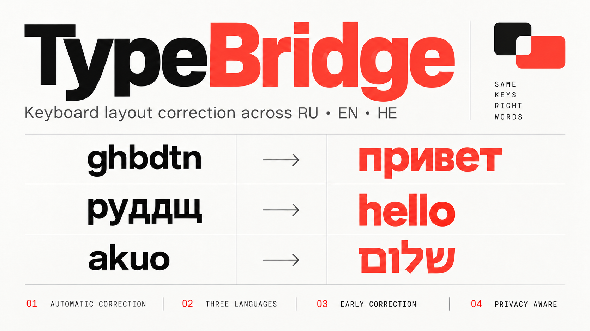

# TypeBridge

This guide describes current development; published builds may differ.

Automatic keyboard layout correction for Windows. Russian, English and Hebrew are included; verified language packages can add other languages. Enable one to three languages at a time.

[Русская инструкция](README-RU.md) · [הוראות בעברית](README-HE.md) · [Roadmap](ROADMAP.md) · [Changelog](CHANGELOG.md) · [MIT license](LICENSE)

**Two build profiles:** `build-typebridge.ps1` automatically creates separate
Public and Diagnostics EXEs from the same Git commit. Only Public is eligible
for GitHub Releases; its frozen EXE excludes typed-content logging even when
debug flags are present. Diagnostics is intended for local troubleshooting only. See
[Build profiles](docs/BUILD-PROFILES.md). Browser password-field protection
remains a separate unresolved limitation.

TypeBridge corrects words typed in the wrong layout, offers manual last-word
conversion and direct layout shortcuts, and expands abbreviations into literal
text templates. It runs locally in the notification area.

**Multiline template warning:** Line breaks and tabs are injected as Unicode
characters, but recipient applications may interpret them as Enter/Tab and
submit a chat message or form, or move focus. Enter/Tab delimiters for
separator-triggered templates are sent as actual keys. Test multiline templates
with harmless text in each application before using them in chats or web forms.

**Password checks and privacy:** native Windows password styles and known
password-manager exclusions are checked. Browser/custom fields require fresh
UI Automation metadata for the focused field. An optional additional check
covers standard Windows fields too; it can reduce compatibility and needs a
full restart after saving. Asynchronous metadata does not guarantee protection
against every focus change or provider error. Exit TypeBridge before entering
secrets if this remaining risk is unacceptable. Clipboard history and the input
journal are independent features. Public excludes typed-content logging.
See [Privacy and input access](docs/PRIVACY.md).

## Features

- Layout correction at word boundaries for enabled languages.
- Optional **Correct before Space** mode: one setting enables early correction
  in supported editors. Native editor and generic keyboard transports are
  selected automatically. Actual compatibility varies by application.
- Manual last-word layout cycling and configurable direct language shortcuts.
- Personal words and exclusions, with optional case sensitivity.
- Optional accidental CapsLock correction: `hELLO` → `Hello`.
- Optional current-layout flag beside the text caret.
- Text expansion: for example `//email` → your address, with instant or separator-triggered rules.
- Optional Windows startup and a saved correction enable/disable setting.

## Download and run

Current sources also include opt-in **Quick search**: open its settings window,
enable it and select text, then press **Ctrl+Alt+G** (configurable). Google is
provided; add other engines or dictionaries with an HTTP/HTTPS URL containing
`{query}`. Search first uses Windows UI Automation. If the field does not expose
a selection, a generic Copy fallback backs up/restores supported clipboard
formats and shows a preview before sending. This works across applications,
without editor-specific adapters; unsupported clipboard formats cause a visible
refusal rather than data loss. These additions are included in builds from
`v0.1.0-alpha.3` onward; the older `alpha.1` download predates them.

The **Privacy** settings tab explains keyboard access, optional recording and
their limits. Read [Privacy and input access](docs/PRIVACY.md) before enabling
clipboard history or the journal. Disabling autocorrection does not disable
those separate features.

For the ready-to-run Windows x64 bundle, open [Releases](https://github.com/lavalava45/TypeBridge/releases),
download the TypeBridge ZIP, extract all files and run `TypeBridge.exe`.
Python and separate dictionary preparation are not required for the bundle.
The first public package is an unsigned alpha with open frequency dictionaries.
Its word and confidence lists are derived from FrequencyWords/OpenSubtitles,
but **numeric** `frequency_{ru,en,he}.tsv` indices are retained as reference
data only: TypeBridge no longer loads or uses them for runtime decisions.

**Native RichEdit transaction (test builds):** normal hooked typing dispatches
RichEdit edits to a dedicated worker outside `WH_KEYBOARD_LL`. Incoming physical
key transitions are briefly held in an ordered, bounded queue and replayed
after the edit and layout request, provided focus has not changed. The worker
admits up to 32 replacement characters; the synchronous fallback remains
limited to 12. An input overflow or unsafe replay quarantines native edits.
Release acceptance still requires physical fast-typing, focus, and Undo tests
on both PCs: passing isolated Win32 tests is not a release guarantee.

If focus changes while input is held, TypeBridge never automatically inserts
those keys into a different field. For eligible printable keystrokes, the tray
can offer **Restore held keystrokes to the original field**. Return to that
field, verify the cursor and layout, and select Restore within three minutes.
This is explicit, in-memory recovery only; shortcuts and uncertain partial
writes cannot be replayed safely. Inspect the resulting text and Undo history.
For browser fields, an unchanged HWND is not sufficient: a click or field
navigation changes the field revision and blocks replay into another DOM input,
including explicit recovery of that stale browser queue.

New version tags automatically build and publish a Windows x64 ZIP with open
dictionaries, instructions in three languages, licenses and SHA-256 checksums.
See [release automation](docs/RELEASING.md). No installation or administrator
rights are needed for ordinary use. Settings, words and templates travel with the `TypeBridge-data` folder beside the EXE.
Use a writable folder; old AppData configuration is copied once without deleting it.

## Run from source

Requires Windows x64, Python 3.12 with tkinter, and installed Russian, English
and Hebrew keyboard layouts. Other language combinations are planned; they are
not implemented yet.

```powershell
git clone https://github.com/lavalava45/TypeBridge.git
cd TypeBridge
py -3.12 -m pip install -r requirements.txt
py -3.12 prepare_dictionaries.py
py -3.12 typebridge_app.py --self-test
py -3.12 typebridge_app.py
```

Enable correction in the settings window. Use **Save settings** to remember
the state for the next launch. Templates have their own enable switch and editor.

Dictionary preparation downloads FrequencyWords/OpenSubtitles word lists. Their
CC BY-SA 4.0 data license is separate from the MIT source-code license. Generated
dictionaries are not committed. Existing local dictionaries are never overwritten.
See [third-party sources](THIRD-PARTY.md).

## Build and check

```powershell
py -3.12 -m pip install -r requirements-build.txt
.\build-typebridge.ps1
py -3.12 -m unittest discover -p "test_*.py"
```

The executable is `dist/TypeBridge.exe`. Automated tests use model input or
withdrawn windows; they do not prove physical typing compatibility in every app.
The **Minimize to taskbar** button and the window X minimize settings without
withdrawing the window: the TypeBridge taskbar button remains available even
if Windows hides its notification-area icon in the overflow. The taskbar
window icon shows the enabled language's flag or code badge; the optional flag by the text caret is a separate
setting. Use the explicit **Exit** command to quit. The Windows shortcuts
panel always shows the built-in Win+Space shortcut separately from optional
legacy registry combinations, which may be absent without indicating an error.
Early correction automatically selects the editor transport. Word and desktop
ChatGPT have specific user-confirmed scenarios; this does not establish universal
compatibility. See [the acceptance record](docs/DESKTOP-EDITOR-COMPATIBILITY.md).

**Program log:** use **Show program log** in settings; it is hidden by default.
The checkbox changes visibility immediately and is saved with **Save settings**.
It is separate from the typed-text journal and file diagnostics.

**Indicators:** RU/EN/HE have flags. Additional enabled languages use code
badges such as AR/ES. The caret indicator hides when the caret position is
unavailable; installing a language pack does not install its Windows layout.

**Automatically correct rare words** affects both completed and early words.
With it enabled, boundary correction uses the full dictionary; before Space,
the early algorithm additionally accepts only an unambiguous, complete rare
word of at least five letters, with no competing language prefix. It never
guesses from an unfinished rare prefix. With the option disabled, the original
confident-word policy applies. **Correct before a space** must be enabled
separately. For example, `lbdthcbz` can become `диверсия` (EN → RU).

## Data and privacy

Current source adds **Русский / עברית / English** interface selection at the top
of Settings. The choice is saved and applied immediately to settings, tray and
tool windows. Hebrew uses right-to-left alignment/layout. It does not change
keyboard layouts, personal words or template content. Pending the next binary build.

Settings, personal dictionaries and templates live in `TypeBridge-data`.
The previous LayoutSwitch data files are copied on first launch without deleting
the old files or overwriting existing TypeBridge files. Typed words and template
contents are not written to the event log. The app has no cloud correction service.

The optional **input journal** in current source (pending the next binary build)
is disabled by default. When enabled, it stores encrypted snapshots of explicitly
allowed text editors every two seconds; Notepad and Notepad++ are the defaults.
It has a visible enabled indicator, configurable 1–365 day retention (default 7),
recovery/copy and manual deletion. Text is protected with Windows user-scoped DPAPI.
Unknown/password fields are skipped; browsers are not supported. Disabling stops
capture and saving, but existing records remain until cleared or expired after
re-enabling. See [roadmap and limitations](ROADMAP.md) for limits.

No binaries containing the private research dictionaries are distributed here.
The source and the open-data preparation path are available for local builds.

[Settings explained](docs/SETTINGS.md)
